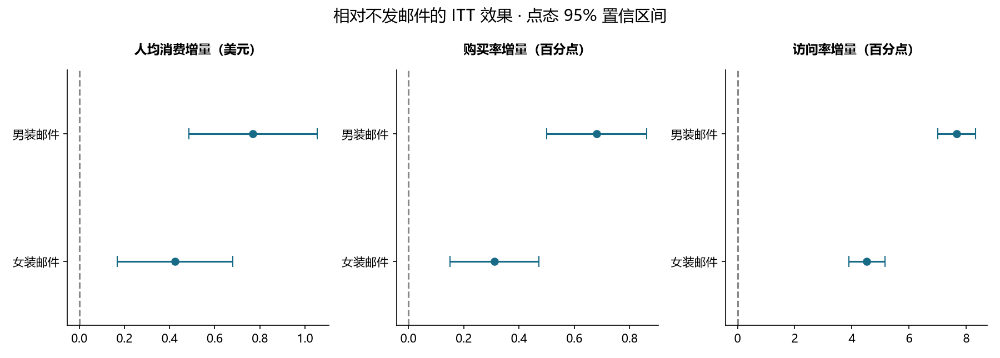
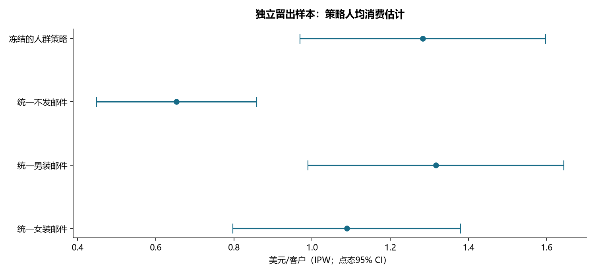

# 营销实验效果评估与人群策略

完成日期：2026-10-23 · 公开随机实验复盘 · 50% 独立策略验证样本

## 决策结论

1. **64,000 名客户**的三组随机实验中，男装邮件相对不发邮件，两周人均消费增加 **$0.770**（95% CI **[0.485, 1.055]**），女装邮件增加 **$0.424**（95% CI **[0.169, 0.680]**）。主检验 Holm 校正 p 值分别为 **2.33e-07** 和 **0.00113**。
2. discovery 样本选出的最佳固定策略为 **Mens E-Mail**。冻结的人群策略相对它，在 validation 样本的人均消费差为 **$-0.033**，95% CI **[-0.316, 0.250]**。
3. **人群策略未证明优于 discovery 选出的固定策略；优先保留简单方案并继续验证。** 不能凭训练样本中某些分组均值更高就承诺个性化投放有效。

## 数据、质量与设计

来源：[Kevin Hillstrom 原始数据发布](https://blog.minethatdata.com/2008/03/minethatdata-e-mail-analytics-and-data.html)。原始下载、大小和 SHA256 见根目录 data_manifest.json。该数据发布于 2008 年，结论仅针对该历史实验；不能外推到今日中国互联网营销。

邮件内容分为男装、女装；这不是客户性别。实验前客户特征和实验后两周结果分开使用。全部未购买客户的 spend=0 保留在分母中；以购买客户为条件计算的消费均值仅供描述。

- 三组人数：{'No E-Mail': 21306, 'Mens E-Mail': 21307, 'Womens E-Mail': 21387}。1:1:1 SRM 卡方检验 p=0.9037，数值与分类基线特征最大绝对标准化差异为 0.0137。平衡检查不能证明一切实验风险都不存在。
- **14 项数据与划分断言通过**。原数据无客户 ID，以源文件行号保持可复现对应；相同特征/结果行不代表重复客户，未盲目去重。
- 方案见 ANALYSIS_PLAN.md，实施前冻结，但属于公开历史数据的回顾性方案，不声称原始预注册或自己上线实验。

| segment       |   customers |   visitors |   visit_rate |   purchasers |   conversion_rate |    revenue |   revenue_per_assigned_customer |   spend_variance |   spend_per_buyer_descriptive_only |
|:--------------|------------:|-----------:|-------------:|-------------:|------------------:|-----------:|--------------------------------:|-----------------:|-----------------------------------:|
| Mens E-Mail   |       21307 |  3894.0000 |       0.1828 |     267.0000 |            0.0125 | 30311.6900 |                          1.4226 |         315.2118 |                           113.5269 |
| No E-Mail     |       21306 |  2262.0000 |       0.1062 |     122.0000 |            0.0057 | 13908.3300 |                          0.6528 |         134.2864 |                           114.0027 |
| Womens E-Mail |       21387 |  3238.0000 |       0.1514 |     189.0000 |            0.0088 | 23038.1100 |                          1.0772 |         228.4967 |                           121.8948 |

## 平均处理效果

| arm           | control       | metric     |   effect |   ci_low |   ci_high |   p_holm |
|:--------------|:--------------|:-----------|---------:|---------:|----------:|---------:|
| Mens E-Mail   | No E-Mail     | spend      | 0.769827 | 0.485140 |  1.054515 | 0.000000 |
| Mens E-Mail   | No E-Mail     | conversion | 0.006805 | 0.005000 |  0.008610 | 0.000000 |
| Mens E-Mail   | No E-Mail     | visit      | 0.076590 | 0.069953 |  0.083226 | 0.000000 |
| Womens E-Mail | No E-Mail     | spend      | 0.424412 | 0.168957 |  0.679868 | 0.001129 |
| Womens E-Mail | No E-Mail     | conversion | 0.003111 | 0.001499 |  0.004724 | 0.000156 |
| Womens E-Mail | No E-Mail     | visit      | 0.045233 | 0.038893 |  0.051573 | 0.000000 |
| Mens E-Mail   | Womens E-Mail | spend      | 0.345415 | 0.032561 |  0.658268 | 0.030469 |
| Mens E-Mail   | Womens E-Mail | conversion | 0.003694 | 0.001743 |  0.005644 | 0.000412 |
| Mens E-Mail   | Womens E-Mail | visit      | 0.031356 | 0.024285 |  0.038428 | 0.000000 |

spend 单位为美元/被分配客户；conversion、visit 的 effect 为概率差，乘 100 得到百分点。相对提升另见 treatment_effects.csv。Welch 均值差检验用于金额与二元指标，大样本二元均值差采用渐近近似。CI 为点态 95%；显著性用对应检验族的 Holm p 值，两者含义不同。

主检验族为两项 spend vs control；四项辅助指标比较单独校正；三项男装 vs 女装直接比较单独列为探索性检验族。未通过“某组显著、另一组不显著”推断组间差异。

长尾消费金额补充用户级组内独立重采样 2,000 次：

| arm           | control       |   bootstrap_ci_low |   bootstrap_ci_high |
|:--------------|:--------------|-------------------:|--------------------:|
| Mens E-Mail   | No E-Mail     |             0.4873 |              1.0647 |
| Womens E-Mail | No E-Mail     |             0.1724 |              0.6792 |
| Mens E-Mail   | Womens E-Mail |             0.0276 |              0.6551 |

## 人群策略：先学习，再验证

按实验组分层，用固定随机种子 20261023 切分 discovery / validation，各 32,000 人。只用实验前购买类型在 discovery 中选择人均消费最高动作，并保存规则；validation 不参与选择。

| purchase_type   | chosen_arm    |   discovery_customers |   discovery_no_email_mean |   discovery_mens_mean |   discovery_womens_mean |
|:----------------|:--------------|----------------------:|--------------------------:|----------------------:|------------------------:|
| both            | Mens E-Mail   |                  3245 |                    0.7394 |                3.6340 |                  1.5593 |
| mens_only       | Mens E-Mail   |                 14408 |                    0.7957 |                1.5666 |                  0.9130 |
| womens_only     | Womens E-Mail |                 14347 |                    0.4853 |                1.0018 |                  1.1173 |

| comparison                    |   effect |   ci_low |   ci_high |   p_raw |   p_holm |
|:------------------------------|---------:|---------:|----------:|--------:|---------:|
| personalized vs No E-Mail     |   0.6299 |   0.2546 |    1.0053 |  0.0010 |   0.0030 |
| personalized vs Mens E-Mail   |  -0.0335 |  -0.3164 |    0.2495 |  0.8167 |   0.8167 |
| personalized vs Womens E-Mail |   0.1945 |  -0.1401 |    0.5291 |  0.2545 |   0.5091 |

策略评估使用已知随机分配概率 1/3 的 Horvitz–Thompson/IPW：只有客户实际接受的处理与策略推荐一致时，贡献为 3×消费金额，否则为零。与固定策略比较时对同一客户的两个伪结果做差，计算配对标准误；没有把相关策略当独立样本比较。

已知分配概率来自原始设计；实际分组人数并非恰好相等，有限样本 IPW 值不必等于直接组均值。金额长尾及分群样本少使验证区间较宽。分组点估计不等同于已证明处理效果异质性；未进行正式交互检验或宣称模型识别出“必被说服”的个人。

## 成本敏感性与下一轮实验

真实成本和毛利缺失，按假设毛利率 20%/40%/60%、单次触达成本 $0/$0.05/$0.10/$0.20 输出 cost_sensitivity.csv。净增益 = 消费增量×假设毛利率−假设触达成本；零成本不代表生产触达实际免费。以 40% 毛利率为例，男装邮件点估计的单次触达盈亏平衡成本为 **$0.308**，不是实测利润。

下一轮实验样本量的正态近似规划（每组人数；两侧 alpha=.025，power=.80）：

| metric     |   target_absolute_effect |   alpha_two_sided |   power |   required_per_arm_approx |
|:-----------|-------------------------:|------------------:|--------:|--------------------------:|
| spend      |                   0.2000 |            0.0250 |  0.8000 |                     63820 |
| conversion |                   0.0020 |            0.0250 |  0.8000 |                     27059 |
| visit      |                   0.0100 |            0.0250 |  0.8000 |                     18041 |

规划使用本次对照组方差作为未来基线近似，未计算误导性的“事后 observed power”；正式新实验需重新确认人群、转化基线与金额分布。spend 的目标差为美元，二元指标的目标差为概率。

建议继续验证 discovery 选出的简单固定策略与不发邮件，同时增加退订、投诉和长期复购护栏。两周数据不能回答长期效果。

## 复现

在根目录运行 `python run_all.py --project experiment`。原始 CSV → 数据质量与分层划分 → SQL 分组指标 → 总体统计推断 → discovery 冻结策略 → validation 评估 → 图表与本报告。全部分析离线运行，不需要 LLM API 或密钥。
